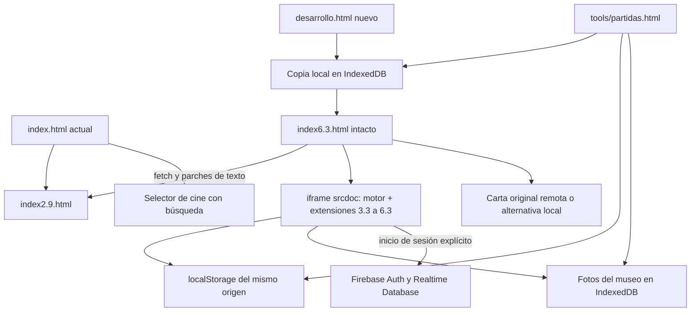

# Dos Mundos 6.3+ · Auditoría de partida

Fecha: 13 de noviembre de 2026. Fase 1 de las siete solicitadas. Esta entrega no implementa todavía la nueva casa RPG.

## Fuentes y respaldo

- Repositorio principal: `jcpages20/dos-mundos`, `main` en `8083ec9a1bf900e8afb318134c77c31b2f37fe07`.
- Carta: `jcpages20/Carta`, `main` en `78cbfc3` (revisada, sin cambios).
- Rama de desarrollo: `feature/casa-pokemon`; respaldo remoto: `backup/main-pre-casa-pokemon-8083ec9`; tag local: `backup/pre-casa-pokemon-8083ec9`.
- Copia completa anterior a los cambios: `dos-mundos-8083ec9.bundle`; `git bundle verify` correcto. SHA-256: `6c55d29d2b366b35c2fa03eea7ba498b3f2eef16be9c7802b0ac82256adb5402`.
- Kit: ZIP SHA-256 `223c5058d20c5676b0437f1dcba37cde91804c6490ad78fa8e6784b24a3e692f`.
- Se leyeron AGENTS, README y todos los documentos del kit, se inspeccionaron las dos ilustraciones conceptuales, las tres capturas de iPhone, la vista previa y los sprites. Se inventarió también el paquete histórico 4.2. Los documentos de contexto se conservan en `docs/kit/`.
- `docs/audit/kit-manifest.json` registra nombres, tamaños, huellas y comparaciones del material recibido. Las referencias conceptuales y capturas no se publican como recursos del escenario.

La instalación del conector de GitHub habilitó la escritura que inicialmente devolvía 403. Se completó la subida en `feature/casa-pokemon`, conservando todos los commits y archivos que el usuario había subido manualmente. Antes de completar la rama se creó y verificó otro bundle con ese historial. Ningún archivo ya subido difería de la entrega preparada. No se modificó `main` remoto ni se publicó una versión.

## Qué versión hay realmente

| Entrada | Situación encontrada |
| --- | --- |
| `index.html` | Lanzador de 4.195 bytes: carga **index2.9.html** en `#juego` e intercepta el botón del cine para abrir Netflix, Max o Disney+, con búsqueda opcional. |
| `index2.9.html` | Base jugable de 176.442 bytes; lógica, movimiento, economía, UI y guardado en una clausura. |
| `index6.3.html` | 491.488 bytes, 4.596 líneas, 351 declaraciones de función detectadas estáticamente. Carga la base 2.9, inyecta extensiones con sustituciones de texto y la ejecuta en `#dm-frame.srcdoc`. |
| `game/index.html` del kit | Idéntico byte por byte a `index6.3.html` de HEAD. SHA-256: `0e757e440f5bb5593765c70d7a644332c595607d05c53e01894524e4489d4d5a`. |
| Historial del kit | 5.9.1, 6.0.1, 6.1, 6.2 y 6.3 coinciden con los archivos homónimos del repositorio. |
| `desarrollo.html` (nuevo) | Abre **6.3 sin editarla**, después de guardar una copia local. Propaga `?gabi=1`, `?carta=1` y fragmento de URL. |

Se comprobó HTTP 200 en `https://jcpages20.github.io/dos-mundos/` (4.195 bytes). Esto verifica disponibilidad de la portada, no un despliegue de esta rama. El prototipo nuevo se prueba bajo una subruta como `/dos-mundos/`, compatible con Pages y sin compilador.

La última subida añadió el archivo 6.3; no actualizó el lanzador principal. Por eso **no basta con sustituir la portada**: se perdería, entre otras diferencias, la búsqueda opcional del selector de cine actual. La promoción de la nueva entrada requiere una comparación funcional al final del proyecto.

## Arquitectura y dependencias actuales

| Sistema que se conserva | Puntos de entrada y dependencias relevantes |
| --- | --- |
| Madrid, edificios, barrios y movimiento | `mapPlaces`, `drawMap` → `dm50DrawMap`, `move`, `cancelWalk`, rutas a las puertas; ampliaciones `dm38OpenMetro`, `dm59Open`, `dm59TravelGate`. |
| Interiores, casas individuales y clima | `openPlace`, `renderInteriorScene`, `roomMove`, `closeInterior`, `dm40GetSave`, `dm40ShowHouse`, `dm40Weather`, `dm40EffectsAfterTime`. |
| JC, Gabi y avatares previos | `DM51_ART`, `dm51Sprites`, `dm51LocalIdentity`, `dm51DrawActor`, `dm52DrawActor`, `sprite25`, editor de apariencia. |
| Economía, trabajos, habilidades, inventario y misiones | `state`, `spend`, `advance`, `refreshUI`, `save`, `careers22`, `doAction`, `completeQuestChecks`, extensiones `dm54*`, `dm55*`, `dm56*`. |
| Cocina, recetas, gimnasio y lectura | `dm55Load`, `dm55Show('cook')`, `dm55ConsumeIngredients`, actividades `dm56Act` y sistemas de necesidades del estado base. |
| Restaurantes, cafetería, cine, parque y viajes | `dm42OpenRestaurant`, `dm37OpenCafe`, `dm33OpenCinema`, acciones base, `dm38OpenMetro`, `travelTo`. |
| Música, radio, arcade y minijuegos | `dm381InstallMusic` (Spotify), `dm39InstallArcade`, `dm39OpenPool`, dardos `dm58Bar`. |
| NPC y relaciones | `dm43*`, `dm54*`, `dm57*`, `startRelationship`, horarios, amistad y diario social. |
| Museo y huerto | `dm58Museum`, `dm58Photo*`, `dm58Garden`, `dm58Tick`; las fotos son locales. |
| Presencia, chat e invitaciones | `dm41Connect`, `dm41Publish`, `dm42OnlineStart`, `dm42SendMessage`, `dm42SendInvite`, `dm52SyncStart`. |
| Casa compartida, citas y álbum | `dm61Load`, `dm61Home`, `dm61Walk`, `dm61Sync`, `dm61Observe`, `dm61Dates`, `dm61Album`. |
| Carta y estrella fugaz | Controlador `dm60-controller`, parámetros de URL, `playOriginal`, `playFallback`, observador del final y `finish`. |

El inventario reproducible `docs/audit/inventory.json` contiene funciones con número de línea, IDs, asignaciones de IDs, selectores por ID, scripts y sus huellas, iframes, literales de almacenamiento, rutas Firebase y orígenes externos. Es un análisis estático: no pretende resolver cada selector o ruta construida dinámicamente. El mapa anterior explica sus dependencias.

## Almacenamiento que no debe migrarse ni borrarse

| Ubicación | Contenido y compatibilidad |
| --- | --- |
| `dos-mundos-v29` | Partida base: dinero, posición en ciudad, atributos, habilidades, inventario, progreso y relaciones. **Es una sola clave por origen**, no dos partidas separadas por rol. Cambiar de avatar no garantiza partidas aisladas. |
| Fallbacks de `loadState` | `dos-mundos-v28`, `v27`, `v26`, `v25`, `v23`, `v22`, `v21`, `v201`, `v20`, `v19`, `v18`, `v17`, `v16`, `v09`, `v071`, `v07`, `v06`, `v1`. Cargar una antigua puede escribir `v29` inmediatamente. |
| `dos-mundos-40-hogar:<nombre codificado>` | Esquema y muebles de casa individual. Clave por nombre, no UID. |
| `dos-mundos-v41-database-url` | URL pública elegida para RTDB. No contiene la contraseña. |
| `dos-mundos-v51-role` | Elección local `jc` / `gabi`; la selección local tiene prioridad sobre la inferencia por UID en el renderer actual. |
| `dos-mundos-v60-prologue-seen-gabi` | Estado de visualización de la carta; `?gabi=1` fuerza repetición e identidad Gabi. |
| `dos-mundos-54-barrio-<rol>` | Compras, amistades y diario del barrio. |
| `dos-mundos-55-progreso:<nombre codificado>:<rol>` | Despensa, cocina, habilidades y progreso de Vida Propia. |
| `dos-mundos-56-visitas:<nombre codificado>:<rol>` | Actividades, lectura, entrenamiento y visitas. |
| `dos-mundos-57-ciudad-<rol>` | Amistades y encuentros de los NPC. |
| `dm58-life-<rol>-<nombre>` | Huerto, cosechas, dardos y visitas. |
| `dos-mundos-61-duo-v1` | Muebles compartidos, invitaciones y recuerdos. No guarda `dm61Avatar`. |
| IndexedDB `dos-mundos-private-museum` / `photos` | Fotos como data URLs, ID, título y autor. No están en localStorage ni en Firebase. |

La herramienta nueva copia todos los valores de `dos-mundos-*` y `dm58-life-*` como **strings exactos**, incluso JSON antiguo inválido o con campos desconocidos. No copia otros proyectos del dominio ni las sesiones de autenticación Firebase.

El `normalize` antiguo reconstruye el estado con campos conocidos y guarda durante la carga: puede descartar campos desconocidos. No se reescribe aquí. La copia anterior al arranque conserva el original; esto no equivale a que el cargador antiguo ya soporte campos futuros. Las casas tienen distintos propietarios y formatos: no se unifican todavía.

## Firebase: evidencia y límites

- Presencia: `dosMundos/duo/presence/<uid>`, escritura del UID autenticado, `onDisconnect().remove()`, envío limitado aproximadamente a 150 ms, heartbeat de 15 s.
- Chat, invitaciones de restaurante y elecciones: `dosMundos/duo/social/messages`, `invites`, `dates/<id>/choices/<uid>`.
- Gestos: `dosMundos/duo/social/gestures/<uid>/<id>`.
- Hogar y álbum: `dosMundos/duo/v61/shared`; `dm61Sync` hace `set` de **todo** el documento, sin transacciones por mueble/asiento. `updatedAt` depende del reloj del cliente y puede resolver conflictos perdiendo una edición concurrente.
- El snapshot de presencia no incluye `dm61Avatar`, habitación interna del hogar compartido, asiento o animación. Usa orientación de calle también en interiores. Todavía no permite ver a Gabi sentada en el sofá compartido.
- Se revisó el JSON histórico de reglas 4.2. Es un fragmento de `social`: no demuestra las reglas desplegadas y no incluye permisos para `v61/shared` ni para todos los añadidos posteriores. No se despliega como reemplazo de reglas.
- Configuración pública de cliente y dos UIDs presentes en el código; no se añadieron secretos, contraseñas ni credenciales privadas.
- Los tres módulos Firebase SDK 13.1.0 referenciados responden HTTP 200. Eso no verifica Auth, permisos RTDB ni sincronización real.
- No se inició sesión en cuentas reales ni se leyó o escribió la base de producción. Sus datos remotos no se exportan en esta fase. Antes de cualquier futura migración remota habrá que exportar las rutas afectadas con acceso autorizado y probar con emulador/datos sintéticos.

## Recursos y defectos observados

Los ocho PNG originales se preservan sin edición en `assets/sprites/`. JC conserva pelo rizado, gafas y camisa; Gabi conserva el pelo con mechones claros y su ropa original. Hay una imagen por orientación y personaje; **no** son hojas con ciclos de marcha ni poses sentado/acostado/cocinando. Las diez imágenes embebidas de 5.1 incluyen variantes reducidas y dos retratos; ambas fuentes se mantienen.

La imagen `dm51_preview.png` muestra piezas incompletas; no debe tratarse como spritesheet utilizable. Los dos conceptos muestran la intención artística, pero no contienen colisiones, capas o frames listos para motor. El catálogo futuro necesita sprites propios y metadatos; recortar el concepto completo como fondo no satisface la casa jugable.

| Hallazgo | Evidencia y siguiente acción |
| --- | --- |
| Casa 6.3 separada y sin colisiones | `dm61Walk` limita coordenadas a un rectángulo; las habitaciones son cambios de botones sobre el mismo canvas 320×240. Fases 2–3. |
| Sentarse no es una interacción física | Se teletransporta a coordenadas fijas y se dibuja el sprite de pie a otra escala. No hay dos asientos reservables ni efectos. Fase 4. |
| Desaparición de muebles compartidos | El botón de un mueble ya comprado lo elimina del array; volver a añadirlo vuelve a cobrar. Hace falta separar propiedad y colocación sin perder compras. Fase 6. |
| Superposición móvil confirmada | En Chromium 390×844 el botón `#dm39-arcade-launcher` intercepta el toque sobre `#dm61-open`. La prueba de referencia no pudo abrir la casa mediante ese toque. Fase 6, con acceso contextual desde escena antes en fases 2–3. |
| Error de carta original confirmado | Dentro del srcdoc, `location.origin` es `"null"`; `postMessage` lanza Invalid target origin. El observador alternativo existente detecta el final y permite entrar. Se conserva el comportamiento y se registra explícitamente en la prueba; corregir antes de publicar estable. |
| Inyección frágil | El lanzador parchea strings exactos de 2.9 y no verifica todos los reemplazos. Extraer por sistemas y añadir contratos antes de mover cada parte. |
| Guardados parcialmente silenciosos | Varias escrituras antiguas capturan y silencian fallos de almacenamiento; la bóveda nueva sí informa del fallo, pero no sustituye esos escritores todavía. |

No se afirma que todos los sistemas estén probados por completo. El inventario confirma su presencia; las pruebas de esta fase cubren el arranque, la conservación de campos seleccionados, las copias y la carta. La matriz completa de juego y dos sesiones sigue pendiente.
