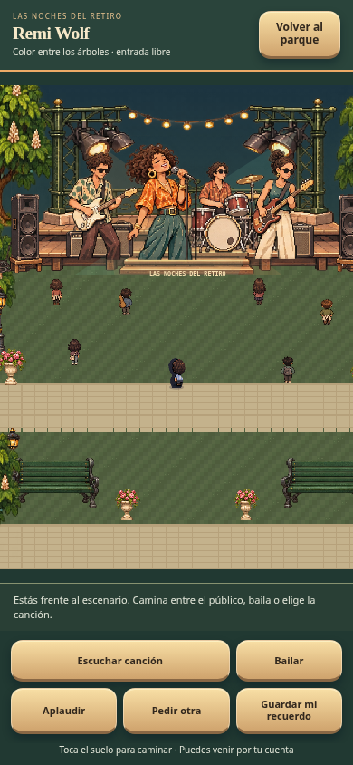
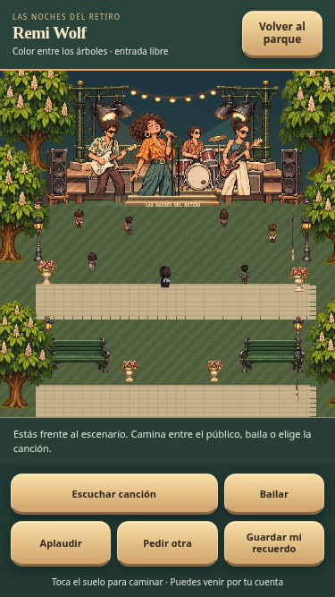
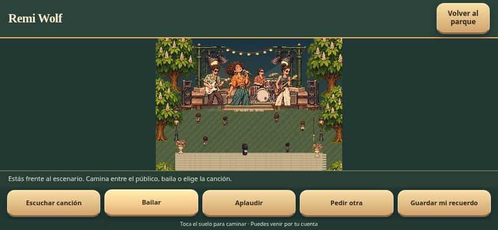
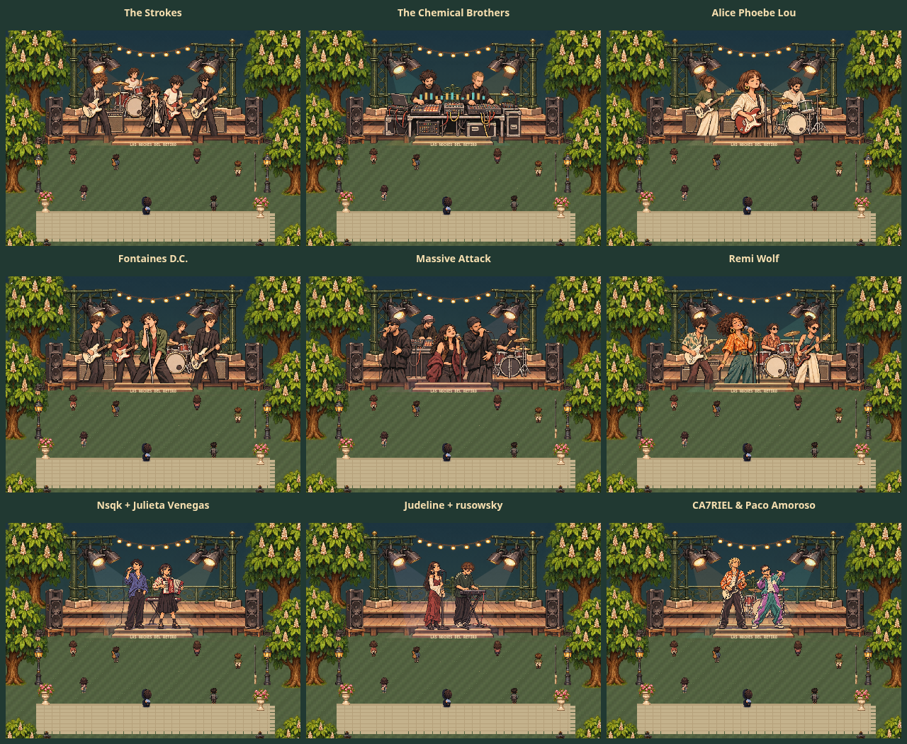

# Las noches del Retiro

Actualización del inicio y la música: [Conciertos en vivo](CONCIERTOS_EN_VIVO.md).
La versión actual mantiene el reproductor visible y ofrece «Empezar concierto»;
el comportamiento de carga y controles descrito en la entrega inicial se amplía
en ese documento.

La cartelera del quiosco abre una escena de concierto dentro del paseo por el
parque. Elegir un grupo hace caminar al personaje hasta el quiosco; volver deja
al mismo personaje junto a su entrada. Calle conserva la salida habitual a Madrid.

Se han preparado nueve actuaciones con ilustraciones originales distintas:
The Strokes, The Chemical Brothers, Alice Phoebe Lou, Fontaines D.C., Massive
Attack, Remi Wolf, Nsqk con Julieta Venegas, Judeline con rusowsky y CA7RIEL &
Paco Amoroso. Cambian los músicos, los instrumentos, la ropa y las luces. Son
conciertos ficticios del juego; las canciones son grabaciones de Spotify.

La selección mezcla la radio pública «las que tengo pegadas» y la lista conjunta
«dedmiau + JC», identificada en las capturas proporcionadas por el usuario.
El enlace de esta última no permite consultar su contenido públicamente (404);
se usaron las capturas y se verificaron los identificadores de sus tres canciones
en las páginas públicas de Spotify. No se atribuyen esas canciones a JC o Gabi
individualmente. No se ha creado ni modificado ninguna playlist.

Hay tres actuaciones por cartelera. Las ediciones duran tres días reales desde
una referencia UTC fija; no dependen del día guardado, del huso horario ni del
personaje. La selección actual alterna ambos grupos de gustos sin repetir una
actuación en carteleras consecutivas. Visitar un concierto no altera el sorteo.
Se rota este catálogo preparado; no existe todavía actualización automática de
artistas nuevos desde Spotify ni generación automática de nuevos dibujos.

Se puede caminar entre el público, bailar, aplaudir, pedir un bis y guardar un
recuerdo propio. No se cobran entradas ni se conceden dinero, XP o necesidades
por pulsar estas acciones. La cámara aprovecha el formato vertical y mantiene
visible al personaje al girar el móvil. Las luces son suaves, el suelo se prepara
una vez y el dibujo se limita a 30 FPS (12 con movimiento reducido).

## Canciones

Se carga el reproductor oficial solamente al pulsar «Escuchar canción». Hay un
enlace a Spotify si el navegador bloquea el marco. Spotify decide la duración
disponible y si requiere iniciar sesión; no se garantiza reproducción completa.
El usuario pulsa reproducir en sus controles. Cerrar música o salir retira el
marco y detiene ese reproductor. Si estaba sonando la radio, se detiene al abrir
la canción para que no se mezclen. No se aloja ni descarga audio.

Fuentes verificadas el 18-11-2026:

- [Radio de Gabi](https://open.spotify.com/playlist/6ODNatWurCvWr89xneT5ss).
- [Heavenly](https://open.spotify.com/track/5Bng1Bwy7PFQys6qByKmdT).
- [Estar Así Siempre](https://open.spotify.com/track/6wpWmv0tcaNwmOXbpPNz43).
- [Sexy Magic](https://open.spotify.com/track/62hqNk13CuFLOpCw1cPMAF).

## Datos y compatibilidad

Nueva clave local: `dos-mundos-conciertos-v1:<role>:<nombre codificado>`, versión 1.
Guarda sólo recuerdos de conciertos. Cada concierto de cada edición se registra
una vez por personaje. Se conservan campos adicionales y no se truncan recuerdos
anteriores. Un registro corrupto, de una versión futura o un fallo de almacenamiento
no se sobrescribe ni produce un mensaje falso de éxito. La copia de partidas ya
incluye la clave por su prefijo. El álbum original se amplía al mostrarlo y no se
reescribe `dos-mundos-61-duo-v1`.

No hay rutas o campos nuevos en Firebase. Se utilizan `room=park`, las coordenadas,
dirección y el campo `place` existentes; este último identifica edición, grupo y
acción, y ya forma parte de la firma usada por el publicador de presencia.
Sólo se dibuja al otro personaje cuando su presencia real, recibida por el
adaptador existente, corresponde al mismo concierto y tiene menos de 45 segundos.
Cada cliente controla exclusivamente su propio personaje. En el parque normal,
un compañero que está en un concierto se representa junto al quiosco. Al salir
se recupera la presencia ordinaria del parque.

El recuerdo es local al dispositivo y personaje que lo guarda. Menciona al otro
personaje sólo si existe presencia reciente en el mismo concierto. No hay aún
sincronización del audio ni de los recuerdos entre dispositivos. La presencia se
ha comprobado con datos sintéticos; faltan dos cuentas Firebase reales a la vez.

`index.html`, `index6.1.html`, versiones históricas, cocina, casa y gimnasio
conservan sus archivos. Blob protegido de `index6.1.html`:
`d46b7742a4968f2ac37d274a3ea47e4fcc1bd0e4`.

## Archivos y pruebas

- Nuevos: `src/concerts/`, `assets/concerts/`, `styles/concerts.css`, pruebas y este documento.
- Integración: lanzador, constructor de adaptadores, puente y escena del parque,
  render del compañero y extensión de la vista del álbum.
- Caché del lanzador y dependencias modificadas: `conciertos=16`. La cocina sigue
  usando sus versiones verificadas 14/15.
- Pruebas unitarias: catálogo, rotación UTC, equilibrio, no repetición, recuerdos
  por personaje, fallos y versiones futuras, validación de presencia, canciones,
  dimensiones y SHA-256 de los PNG originales.
- Navegador: entrada física con ambos personajes, colisiones, movimiento táctil y
  teclado, salida, recuerdos y recarga, reproductor bajo demanda, tamaños móviles,
  movimiento reducido, nueve diseños y presencia sintética.
- Regresión: parque y plaza, economía nativa, vecinos, teléfono/chat/radio/planes,
  casa, carta y estrella, telas aéreas, cocina con tablero fijo, álbum y salida del cine.

Ejecutar los módulos de pruebas unitarias directamente con Node para mostrar los
casos individuales (`node tests/concert-model.test.mjs`), y navegador mediante
`python tests/concert_browser.py`. Usar perfiles desechables, nunca partidas reales.

## Despliegue y reversión

Base: `88da30b797f24627bc80839664432fa5f864fe78`.
Rama: `feature/conciertos-retiro`. Copia local previa en
`/workspace/backups/dos-mundos-antes-conciertos-88da30b.bundle` y rama remota
`backup/main-pre-conciertos-88da30b`.

Publicar mediante PR hacia `main`, comprobar GitHub Pages y abrir
`casa-rpg.html?conciertos=16` con perfiles nuevos de JC y Gabi. Para revertir,
revertir el merge de esta entrega y volver a desplegar; conservar la clave de
recuerdos para que reaparezcan cuando se recupere la función. No borrar guardados.

Resultados locales: 99 pruebas unitarias, 8 de conciertos y 20 de regresión de
navegador superadas (127 casos distintos). Trece módulos pasan `node --check` y
el diff pasa `git diff --check`. La captura de los nueve grupos se comprobó tras
el ajuste de lienzos de ResizeObserver, verificando píxeles pintados.

Las limitaciones pendientes son la prueba simultánea con dos cuentas reales,
la escucha completa según la cuenta de Spotify y la actualización automática de
la biblioteca. Se comprobará también la entrega publicada antes de compartir el enlace.
