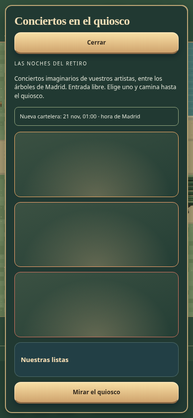
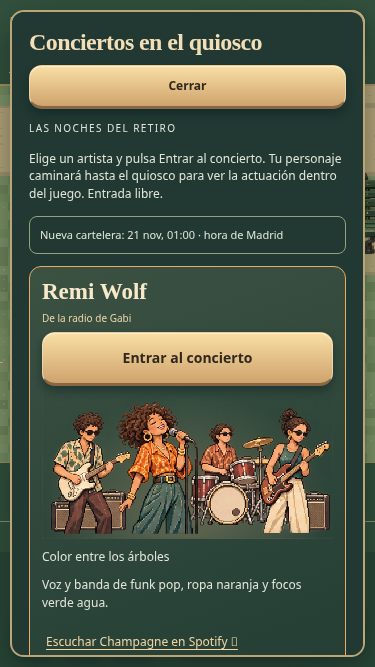
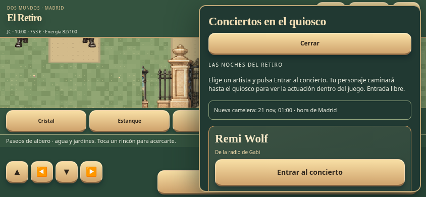

# Entrada al concierto visible en móvil

La cartelera usaba filas de CSS Grid dentro de un panel de altura limitada. Las
tarjetas con `overflow:hidden` se encogían y recortaban su título y botones. En
la reproducción a 390×844, la primera tarjeta medía 131.66 px y terminaba en
y=397.66, pero su botón estaba entre y=566.47 e y=610.47. El panel exterior ni
siquiera tenía desplazamiento: `scrollHeight=clientHeight=820`. El jugador veía
los enlaces de las listas y podía abrir Spotify sin encontrar la entrada al juego.

La cartelera ahora es una columna flexible cuyas tarjetas conservan su altura
natural. Se desplaza el panel completo. El botón principal dice **Entrar al
concierto**, tiene 54 px de altura y aparece justo bajo el nombre del artista,
antes de la ilustración. Su etiqueta accesible incluye el nombre del grupo.
El enlace externo a Spotify sigue disponible debajo del contenido de cada tarjeta.

El recorrido conserva el movimiento físico hasta el quiosco, la escena, los
sprites originales y el botón Empezar concierto dentro de la actuación. No se
cambian música, repertorios, economía, recuerdos ni claves de guardado.

## Regresión comprobada

Las pruebas anteriores usaban `Locator.click()`, que puede desplazar incluso un
contenedor con overflow oculto para alcanzar un botón. Eso permitía pulsar en la
automatización una entrada que no era accesible con el dedo. Las nuevas pruebas
comprueban los rectángulos de los botones contra las tarjetas, el desplazamiento
del panel y el elemento realmente situado bajo el punto de toque. La entrada se
pulsa con `touchscreen.tap`, sin desplazamiento automático de un contenedor interno.

Se revisan 320×568, 375×667, 390×844 y 844×390. Se comprueba también que no se
abre una pestaña de Spotify al entrar y que se llega a la escena, se inicia la
actuación y se conserva el progreso. La suite de conciertos y regresiones de
casa, carta/estrella de Gabi, cocina, cine y actividades anteriores se ejecutan
con perfiles desechables y un contrato simulado del reproductor.

Resultado local: 13 pruebas de conciertos y 5 de compatibilidad superadas. Las
dos nuevas pruebas cubren el recorte de la cartelera y la entrada mediante un
toque; se verificó también sintaxis, diff y la integridad del HTML histórico.

## Publicación y datos

Archivos de producto cambiados: cartelera, estilo y referencias del lanzador a
las dependencias modificadas. Nueva versión de caché: `conciertos=18`. El
reproductor, animaciones y cocina mantienen sus versiones anteriores. No hay
migraciones ni cambios en rutas Firebase. El HTML 6.1 mantiene el blob
`d46b7742a4968f2ac37d274a3ea47e4fcc1bd0e4`.

Base: `9f1d28b79c4fe5c930a2236c995add3f108841f3`. Rama:
`fix/conciertos-entrada-visible`. Respaldo remoto:
`backup/main-pre-entrada-conciertos-9f1d28b`; bundle local:
`/workspace/backups/dos-mundos-antes-entrada-conciertos-9f1d28b.bundle`.

Publicar mediante PR y Pages; comprobar
`casa-rpg.html?conciertos=18` y `?gabi=1&conciertos=18`. Para revertir, revertir
el merge conservando todas las partidas y recuerdos. Pendientes de verificación
siguen el iPhone físico y dos cuentas reales de Firebase conectadas a la vez.
