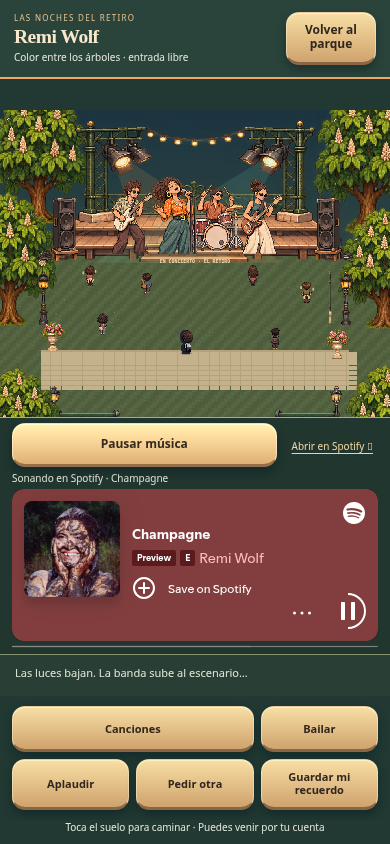
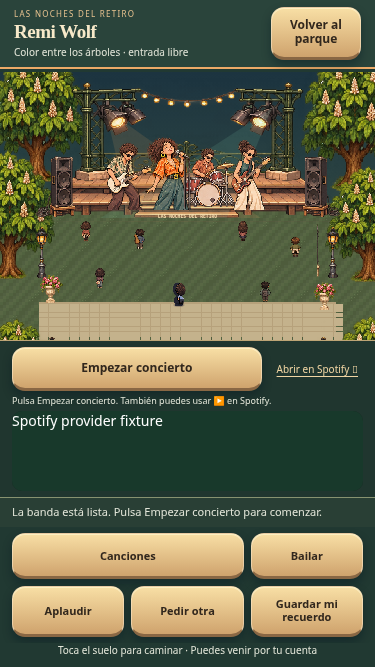
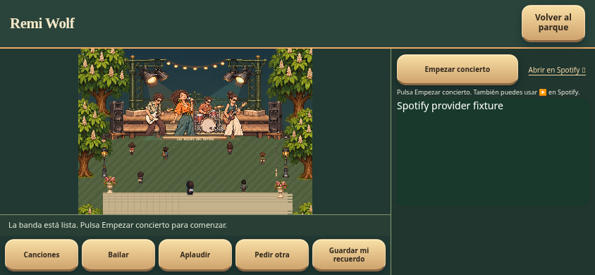

# Conciertos: inicio, animación y música

La primera entrega permitía entrar, pasear y ver los músicos, pero no tenía un
inicio de actuación y su reproductor no comunicaba si estaba sonando. Esta
corrección añade «Empezar concierto», cuenta atrás, entrada visual de la banda,
poses articuladas y un reproductor oficial visible durante toda la actuación.

El botón espera a que Spotify prepare sus controles. Al pulsarlo se solicita la
reproducción desde el gesto del usuario y comienza la presentación. Se muestran
el estado real, el progreso recibido del proveedor, pausa, reanudación y final.
El repertorio se abre sin retirar ni reiniciar la música; «Pedir otra» cambia a la
siguiente canción y produce aplausos. Al salir se destruye el reproductor.

Si el navegador bloquea el controlador, sigue disponible el iframe directo y
el enlace a Spotify. El juego nunca etiqueta el audio como sonando sin recibir
sus señales. La animación puede continuar mientras espera a que se pulse ▶.
La radio se detiene cuando se inicia esta música, evitando dos canciones a la vez.

Hay tres canciones verificadas por actuación, 27 en total. Se conserva como
primera la canción aportada en vuestras listas; las otras dos amplían el repertorio
con títulos del mismo artista comprobados en sus metadatos públicos de Spotify.
No se ha creado ni modificado una playlist de la cuenta del usuario.

Dos atlas originales contienen tres poses por cada uno de los nueve grupos.
Cambian brazos, rasgueos, baquetas, postura y manos sobre teclas/acordeón. El
manifiesto guarda sus rectángulos, dimensiones y SHA-256; los PNG se conservan
sin retoques posteriores. Se carga sólo el atlas que contiene la banda elegida;
la ilustración anterior sigue sirviendo mientras carga. El público acompaña,
aplaude y reacciona al bis. El modo de movimiento reducido usa una pose fija.

Los únicos sonidos propios son la cuenta de entrada y aplausos procedurales
originales mediante Web Audio. No imitan ni sustituyen las canciones del grupo.
El audio de las canciones siempre lo sirve Spotify. No hay audio de artistas en
el repositorio, descargas de previews ni claves privadas.

## Comprobaciones

Pruebas de navegador con un contrato simulado del proveedor: inicio y cuenta
atrás; señales de reproducción, pausa y reanudación; controles directos; fallo
del script; bloqueo de autoplay sin falso mensaje de éxito; cambio de canción;
destrucción del iframe al salir; memoria sin cambios económicos; nueve grupos;
poses 0/1/2 y cámara al girar cerca del fondo. La cámara se corrigió para tener
en cuenta el espacio ocupado por el nuevo reproductor.

Se probó también el SDK y reproductor **reales**, sin cuenta, en Chromium con
formato móvil: Spotify informó `playing`, con progreso 5.022 s y 10.223 s en una
muestra disponible de 15.608 s de «Champagne». Esta es evidencia del reproductor,
distinta de las pruebas simuladas. El contenedor exterior conserva permisos de
autoplay y medios cifrados. No se ha probado en un iPhone físico ni con Spotify
Premium. Spotify decide si ofrece muestra o canción completa; la animación no
puede cambiar esa disponibilidad.

La sincronización de presencia existente no cambia; siguen pendientes dos cuentas
Firebase reales conectadas a la vez. Audio y recuerdos siguen siendo locales.
La rotación de cartelera continúa cada tres días reales y usa el mismo catálogo.

## Compatibilidad y publicación

No se migran claves, campos ni rutas Firebase. No cambian economía, XP, ingredientes,
cocina, casa, gimnasio, cartas, estrellas o HTML históricos. Los recuerdos antiguos
se conservan; los nuevos pueden guardar el título que se está escuchando.

Nuevos archivos: `src/concerts/performance.mjs`, `spotify-player.mjs`,
`concert-sound.mjs`, `setlists.mjs`, atlas de animación y pruebas. Los cambios
restantes se limitan al concierto, sus estilos y referencias de importación.
Versión de caché: `conciertos=17`; cocina conserva sus versiones 14/15.

Rama `fix/conciertos-inicio-y-animacion`, base publicada
`f3761fdfdc2d74c4434cff6c078637faa3d0d622`. Copia anterior:
`backup/main-pre-concierto-vivo-f3761fd` y
`/workspace/backups/dos-mundos-antes-conciertos-en-vivo-f3761fd.bundle`.

Publicar por PR, esperar Pages y comprobar
`casa-rpg.html?conciertos=17` y `?gabi=1&conciertos=17`. Para revertir, revertir
el merge y redesplegar; conservar todos los guardados y recuerdos.

Fuentes técnicas: [API oficial del reproductor](https://developer.spotify.com/documentation/embeds/references/iframe-api),
[guía de integración](https://developer.spotify.com/documentation/embeds/tutorials/using-the-iframe-api).

Resultados: 106 casos unitarios, 11 de conciertos y 20 de regresión de navegador
superados (137 casos distintos), además de la prueba del proveedor real. Se
verificaron sintaxis y diff; el HTML 6.1 mantiene el blob
`d46b7742a4968f2ac37d274a3ea47e4fcc1bd0e4`.

