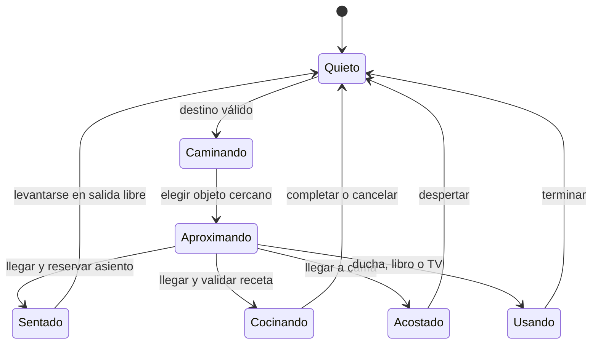

# Plan técnico · Dos Mundos 6.3+

Referencia conservada: 6.3 original + portada y cine actuales; la versión 6.1 sigue disponible como entrada histórica. Desarrollo incremental por ramas y PRs revisables. La primera casa se ofrece en `casa-rpg.html` como prueba adicional. No sustituir la entrada estable hasta superar la matriz completa.

| Fase | Implementación y módulos previstos | Criterio verificable para cerrar |
| --- | --- | --- |
| 1 · Auditoría y protección | Inventario, respaldo Git, PNG originales, entrada optativa 6.3, `src/persistence` y UI de copias. | Completada: restauración, integridad, fallos de cuota, versiones anteriores y carta verificadas. |
| 2 · Escenario de la casa | Motor, mapa, atlas de muebles y renderer en módulos separados. | Primera entrega en `casa-rpg.html`: cuatro espacios, pasillo/puertas, entrada/salida de Madrid y recorridos con colisiones. Detalles en `CASA_RPG_FASE_2.md`. |
| 3 · Personajes y movimiento | `src/characters`: atlas original con pivote en los pies, cuatro direcciones, pasos de marcha e idle; colisiones y rutas en el motor. | Identidad correcta para JC y Gabi; colisión con paredes/muebles; interacción accesible desde los cuatro tamaños de pantalla. Ningún avatar genérico como sustituto permanente. |
| 4 · Interacciones | `src/interactions` con estados; adaptadores de economía, alimentación, habilidades y tiempo ya existentes. | Acercarse y sentarse en dos plazas; levantarse con salida válida; cocina real con receta/ingredientes; cama recupera energía; ducha mejora higiene; lectura mejora habilidad; mesa consume comida; TV enciende/apaga y permite elegir actividad. No duplicar cobros/efectos al reconectar. |
| 5 · Dos jugadores | `src/multiplayer`, emulador y pruebas de dos clientes. Reglas por UID, esquema nuevo aislado y compatibilidad con las rutas antiguas. | Control exclusivo del avatar propio; presencia/estados coincidentes; reserva atómica de asientos; reconexión; un cliente offline; cambios concurrentes sin sobrescribir hogares/álbum anteriores. |
| 6 · Decoración y móvil | Catálogo con sprites, propiedad/instancias y colocación; estilos clásico, moderno, rústico y acogedor; `src/ui` contextual. | Comprar una vez con economía existente, mover sin recobrar, conservar muebles guardados, impedir bloquear puertas; botones sin solapamiento, zonas seguras iPhone, retrato y paisaje, foco y controles táctiles cómodos. |
| 7 · Estabilizar y publicar | Regresión integral, rendimiento, documentación de despliegue y rollback; revisión y promoción del lanzador. | Dos cuentas de prueba y Safari en iPhone real; matriz anterior sin pérdidas; cine/búsqueda actual preservados; carta repetible y sin error; Pages publicado y verificado. |

## Motor y diseño de la vivienda

Canvas 2D con resolución lógica fija, tiles de 16 px escalados a múltiplos enteros, cámara que recorre un mapa mayor que la pantalla. Paredes superiores visibles y frontales recortadas; capas de suelo, alfombras, objetos, actores ordenados por pies y elementos superiores. Desactivar suavizado para pixel art. La interfaz no participa en las colisiones ni se pinta como muebles.

Diseñar un plano original con salón y cocina comunicados, dormitorio y baño mediante pasillo/puertas. Salón: sofá de dos plazas, TV/mueble, mesa de centro, alfombra, librería, plantas, lámparas, cuadros y ventanas. Cocina: nevera, fogones/horno, fregadero, encimera/armarios, mesa y sillas, utensilios y comida. Dormitorio: cama doble, mesitas/lámparas, armario, espejo, cómoda, alfombra y ventana. Baño: ducha, lavabo/espejo, inodoro, toallas y armario; bañera solo si queda circulación suficiente; suelo de baldosas. Iluminación/sombras dibujadas en paleta propia, sin copiar sprites o tiles de Nintendo.

Cada definición de mueble tendrá `id`, nombre, precio, estilo, ruta del atlas y frame, tamaño, pivote, huella de colisión, puntos de aproximación, interacciones y anclajes de postura. La instancia tendrá `instanceId`, definición, posición, orientación y propietario/estado de colocación. El tamaño visual puede superar la huella física. Los muebles, incluido el sofá, deben ser reconocibles sin etiquetas ni emojis sobre rectángulos.

Las animaciones nuevas se derivarán de los personajes suministrados, conservando rostro, pelo, gafas, ropa y proporciones. Mantener los PNG fuente inmutables y versionar cada atlas nuevo con revisión visual. Una imagen por dirección permite orientar, pero no basta para afirmar que hay ciclos de marcha o poses completas.

## Máquina de estados y efectos

Separar selección contextual, reserva del recurso, ruta a la aproximación, animación y aplicación del efecto. El efecto de una acción lleva identificador idempotente y lo aplica el propietario de su personaje: dinero, inventario, necesidades y habilidades siguen pasando por adaptadores del estado existente. TV puede compartir actividad; el vídeo de plataformas externas conserva sus propios requisitos de reproducción y no se promete emitir su contenido dentro del canvas.

## Red y compatibilidad de datos

Proponer un nuevo espacio versionado para la escena, por ejemplo `dosMundos/duo/v64`, sujeto a reglas y pruebas antes de utilizarlo. Mantener intactos `presence`, `social` y `v61/shared`. No cambiar el guardado principal `v29` ni pasar partidas completas por presencia.

- `players/<uid>`: identidad validada por UID, escena/sala, pies X/Y, orientación, animación, estado de acción, asiento, secuencia y timestamp de servidor. Interpolación remota; frecuencia limitada y limpieza con `onDisconnect`.
- `seats/<seatId>`: reserva mediante transacción, UID, vencimiento y liberación al levantarse/desconectar. El vencimiento evita asientos bloqueados por cierres abruptos. Probar carreras de dos clientes.
- `home/instances/<instanceId>`: muebles y revisiones; actualización de una instancia, no `set` de toda la casa. Reglas validan límites, propietario y formato.
- Partida local y compras: leer formatos antiguos sin borrarlos. Preparar conversor aditivo y repetible, con registro de origen y copia previa. No filtrar silenciosamente muebles desconocidos. Los muebles de las casas individuales no se consumen para crear el hogar compartido.
- SDK y cliente no sustituyen a las reglas del servidor. Probar UID ajeno, escritura del avatar del otro, doble asiento, doble compra, latencia, offline y reconexión en emulador antes de producción.

La extracción del monolito será por puntos estables: primero persistencia nueva (esta fase), luego datos/render de casa, después controladores y adaptadores; retirar cada parche legado solo al demostrar que el módulo conserva su comportamiento. No crear módulos vacíos ni reescribir todos los sistemas de una vez.

## Matriz de regresión para las siguientes entregas

Además de la casa, mantener controles para Madrid/edificios y barrios, movimiento, economía/trabajo/habilidades, gimnasio/deportes, cocina/recetas, restaurantes/café/cine con búsqueda, parque/metro/viajes, arcade/minijuegos, NPC, día/noche/clima, música/radio, chat/Firebase, casas individuales/decoración, citas/álbum, museo/huerto/misiones, guardados y carta/estrella. Separar en los informes: comprobación estática, smoke test automatizado, prueba manual y prueba real de dos cuentas. Una categoría no implica las otras.
