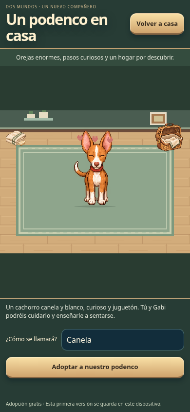
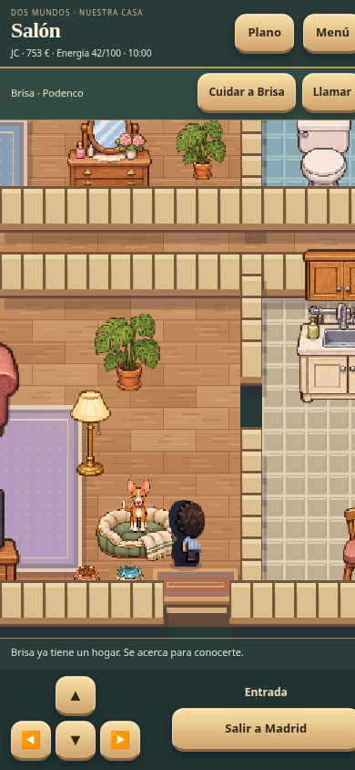
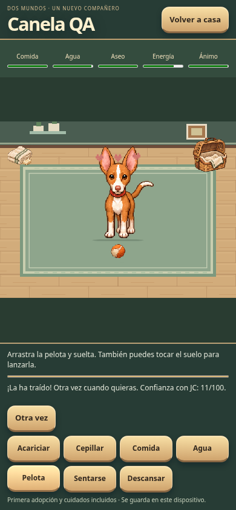
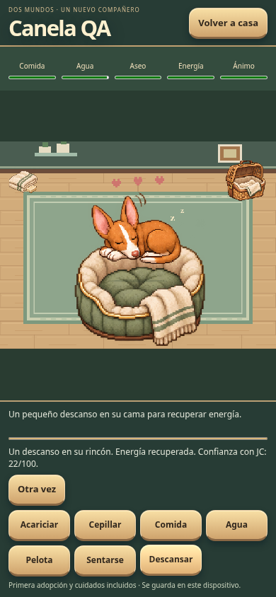

# Un podenco en casa · primera entrega táctil

Desde `casa-rpg.html?mascota=20`, entrar en casa y pulsar **Conocer al podenco**.
Se puede ver al cachorro y salir sin adoptar ni escribir ningún dato. Adoptarlo
es gratis, permite elegir su nombre y lo deja físicamente en su rincón del salón.
Después, **Cuidar a …**, tocarlo en el escenario o el menú de casa abren sus
cuidados. Si está lejos, el personaje camina primero a su lado. **Llamar** hace
que el cachorro se acerque por un camino libre.

El ajuste móvil posterior fija la columna de la casa al ancho visible: antes su
mínimo intrínseco llegaba a 408 px y recortaba el extremo derecho en móviles de
390 px. `grid-template-columns: minmax(0,1fr)` evita el recorte. La entrada,
constructor de adaptadores y CSS de mascota usan ahora caché `mascota=20`; los
módulos de lógica mantienen la versión 19. Se comprueban ancho real, nombres de
24 caracteres y todos los botones de la barra en los cuatro tamaños móviles.
No se cambia el mapa ni ningún dato guardado. Base del ajuste: `0daf1ff`; rollback:
revertir únicamente este ajuste de CSS/caché, conservando la mascota.

## Comportamiento y gráficos

Podenco original canela y blanco, collar rojo, cuerpo esbelto y orejas grandes.
Atlas de 24 poses: quieto/parpadeo, sentado, patita, caminar en cuatro direcciones,
tumbado, dormir, comer y alegría. Nueve objetos originales: cama, comida, agua,
pelota, cepillo, premios, toalla, cesta y collar. PNG transparentes con recortes
definidos en `assets/pets/pet-atlas.json`; el manifiesto incluye dimensiones y
SHA-256. No se usan recursos de Nintendo ni de Nintendogs.

El cachorro vive en el escenario existente, con orden de profundidad respecto a
JC/Gabi y los muebles. Reutiliza `findPath`, `moveSafely` y las colisiones de la
casa; la planificación se limita a una vez cada 1,25 segundos. Sigue al personaje,
explora y se sienta o duerme cuando está tranquilo. Su posición de llegada está
en `(316,484)`. Cama y cuencos son accesorios blandos de suelo, sin añadir barreras
a las puertas o a los recorridos de los muebles. No se cambia el mapa original,
las decoraciones, el perro del barrio ni los sprites humanos.

## Cuidados jugables

| Actividad | Gesto | Resultado guardado |
| --- | --- | --- |
| Acariciar | Deslizar sobre el cachorro o mantener el dedo | Ánimo y confianza con el personaje actual |
| Cepillar | Pasar el cepillo o mantenerlo sobre el pelo | Aseo y ánimo |
| Comida / agua | Tocar el cuenco o al cachorro | Animación de comer/beber y necesidad recuperada |
| Pelota | Arrastrar y soltar, o tocar el suelo | Lanzamiento, persecución, recogida y regreso; ánimo, pequeño gasto de energía/agua y primer logro |
| Sentarse | Elegir la orden y tocar el premio cuando se siente | Tres lecciones premiadas enseñan la orden; progreso y logro persistentes |
| Descansar | Elegir su cama | Animación durmiendo y energía recuperada |

Los cuidados iniciales están incluidos: no se descuentan euros, ingredientes o
XP de los personajes. Las necesidades bajan suavemente fuera del juego, con
límites amables y recuperación de energía. No hay muerte, enfermedad o castigos
por no abrir la partida.

Una actividad incompleta no se registra. La pelota cuenta al regresar; la orden
cuenta al premiarla. Un gesto cancelado no completa una caricia ni ofrece comida.
Los botones tienen al menos 44 px, se admite un dedo a la vez y no hay objetivos
pequeños ni gestos rápidos obligatorios. No hay voz, micrófono, cámara o permisos.

La vista usa el bloqueo de pantalla ya probado en la cocina, sin modificarlo.
La simulación y los eventos se atienden desde el bucle de la casa; se pinta como
máximo a 30 FPS, o 12 con movimiento reducido. Las coordenadas del gesto se fijan
al empezar; no se leen dimensiones en cada movimiento. Cambiar la altura del
navegador no mueve el tablero durante el gesto, incluso si ya se ha completado.
Al salir se restauran los estilos y el movimiento del personaje.

## Guardado y alcance del multijugador

Nueva clave, sin migraciones: **`dos-mundos-mascota-v1`**, esquema 1. Una mascota
por almacenamiento del navegador, con nombre, necesidades, contadores, logros,
aprendizaje y confianza separada con JC/Gabi. Ambos roles del mismo navegador
pueden cuidarla. **Todavía no se comparte el mismo cachorro entre dos móviles.**
No se añaden rutas Firebase ni se simula al otro jugador. Paseos por el parque y
sincronización real entre dispositivos quedan para una entrega posterior.

No se tocan claves antiguas. La herramienta `tools/partidas.html` ya incluye el
nuevo registro por su prefijo; se ha verificado exportación y restauración.
Los campos desconocidos se conservan. Registros corruptos o de versión futura
quedan intactos y no se pueden modificar desde esta versión.

Cada actividad usa identificador y revisión. Web Locks coordina ventanas cuando
está disponible; el respaldo compara el registro antes de escribir. Revisiones
obsoletas se rechazan, los reintentos conservan el identificador y los premios no
se duplican. Se conserva un recibo acotado de 32 acciones; una acción más antigua
tampoco se puede reaplicar porque lleva una revisión anterior. Un fallo de cuota
mantiene el registro anterior y permite reintentar **Guardar cuidado**. No se
muestra éxito hasta que el almacenamiento confirma la escritura.

## Archivos y despliegue

Nuevos módulos en `src/pets/`: modelo, almacén, gestos, atlas, movimiento, render,
interfaz táctil e integración en casa. Nuevos `styles/pets.css`, atlas PNG y
manifiesto, `tests/pet-model.test.mjs`, `tests/pet_browser.py`, este documento y
cuatro capturas en `docs/podenco-tactil/`.

Integración incremental en `house-scene.mjs`, `house-renderer.mjs` y
`install-house.mjs`. El lanzador, constructor de adaptadores y `casa-rpg.html`
cargan la nueva versión de caché `mascota=19`. La cocina conserva exactamente sus
dependencias verificadas `cocina=14/15`; conciertos conserva `conciertos=18`.
`index.html`, `index6.1.html`, `index6.3.html`, la carta y sus claves permanecen
sin cambios. Blob protegido de 6.1:
`d46b7742a4968f2ac37d274a3ea47e4fcc1bd0e4`.

Base: `61b9bc71197a854a9662c1b2c71e4d849617f2d7`. Rama de desarrollo:
`feature/podenco-tactil`. Copia local previa:
`/workspace/backups/dos-mundos-antes-podenco-61b9bc7.bundle`; copia remota:
`backup/main-pre-podenco-61b9bc7`.

Publicar mediante PR a `main`, esperar el despliegue de Pages y comprobar la URL
pública. Rollback: revertir el merge o volver al commit base; conservar la clave
de mascota para recuperar su progreso al reactivar la funcionalidad. No borrar
datos ni cambiar la fuente de Pages. Una descarga de dibujos fallida ofrece
reintento y permite volver a la casa jugable.

## Comprobaciones

Pruebas con perfiles sintéticos, tráfico remoto bloqueado y Chromium con tacto
móvil. Los resultados finales y la comprobación pública constan en el PR.

Resultado local final: **119 casos unitarios** (106 existentes + 13 nuevos) y
**34 pruebas de navegador** (8 de mascota, 22 de casa/copias/prólogo y 4 de
regresión de cocina/concierto), todos correctos. Los dos atlas pasan la
verificación de dimensiones, hash, límites de fotogramas y transparencia.

- `node tests/pet-model.test.mjs`: 13 casos de modelo, guardado, reintentos,
  revisión obsoleta, compatibilidad, gestos y recorridos sin atravesar muebles.
- `python3 tests/pet_browser.py`: adopción voluntaria, siete cuidados mediante
  tacto real, cancelaciones, fallo de cuota, recarga, ambos roles, copia y
  restauración, registro futuro, recursos ausentes y restauración de pantalla.
- Tamaños 390×844, 375×667, 320×568 y 844×390: proporción del tablero, ausencia de
  desbordamiento y botones realmente alcanzables mediante hit testing.
- Regresión de casa y copias; cocina con receta completa, altura variable y
  restauración de estilos; entrada al concierto mediante tacto.

No se ha probado un iPhone físico ni dos cuentas Firebase con esta mascota. No se
afirma que esta entrega implemente paseos, 3D o sincronización de cuidados.

